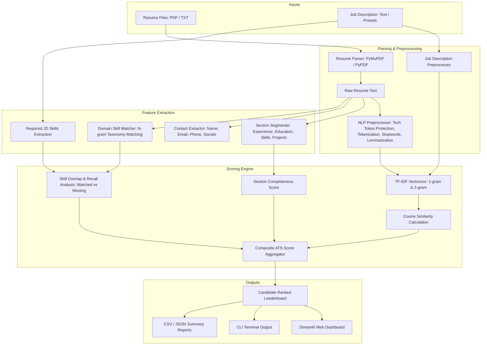

# AI-Powered ATS Resume Screener & Candidate Ranking System

An intelligent, production-ready Applicant Tracking System (ATS) that automatically parses resumes (PDF and Plain Text), extracts structured information (skills, education, experience, contact details), and ranks candidates against job descriptions using NLP preprocessing, TF-IDF vectorization, Cosine Similarity, and domain skill matching.

---

## 🌟 Key Features

- **Multi-Format Parsing**: Extracts text from PDF documents (via high-speed PyMuPDF with PyPDF fallback) and plain text (`.txt`) files with robust multi-encoding support (UTF-8, Latin-1, CP1252).
- **Domain-Specific NLP Preprocessing**:
  - Technical token protection (preserves critical terms like `C++`, `C#`, `.NET`, `Node.js`, `CI/CD` from being stripped by punctuation filters).
  - Stop word removal and WordNet lemmatization with Porter stemming fallback.
- **Structured Section & Entity Extraction**:
  - Automatically identifies and segments `Skills`, `Experience`, `Education`, `Projects`, `Summary`, and `Certifications`.
  - Extracts candidate contact details (Name, Email, Phone number, LinkedIn, GitHub profiles).
  - Recognizes academic degrees (`Ph.D`, `Master of Science`, `B.Tech`, `Bachelor of Science`, etc.).
- **Hybrid ATS Scoring Algorithm**:
  - **TF-IDF Cosine Similarity** for overall semantic context and vocabulary alignment (with unigram + bigram support).
  - **Skill Recall & Overlap Analysis**: Precision matching against a domain taxonomy; detects **Matched Skills**, **Missing Skills**, and **Bonus Skills**.
  - **Section Completeness Scoring**: Evaluates structural completeness across essential resume sections.
- **Dual User Interfaces**:
  - **Interactive Streamlit Web Dashboard**: Mobile and desktop responsive design with fluid typography, touch-friendly controls (min 46px tap targets), responsive metric tiles (auto-fitting 4-col desktop, 2-col tablet/phone), mobile candidate cards view with score tags, interactive Plotly skill gap charts, and one-click CSV/JSON export.
  - **Headless CLI Utility**: Automates batch resume screening for pipelines and shell workflows.
- **100% Offline & Fully Reproducible**: Self-contained local NLTK data; requires zero external paid API keys.

---

## 📐 System Architecture



---

## 🧠 Scoring & Ranking Algorithm Explained

The ATS system computes a **Composite ATS Match Score** ($S_{\text{total}}$) ranging from **0.0% to 100.0%**:

$$S_{\text{total}} = 100 \times \left( w_{\text{tfidf}} \cdot S_{\text{tfidf}} + w_{\text{skill}} \cdot S_{\text{skill}} + w_{\text{sec}} \cdot S_{\text{sec}} \right)$$

Default weights:
- $w_{\text{tfidf}} = 0.50$ (50% Context & Vocabulary Similarity)
- $w_{\text{skill}} = 0.40$ (40% Direct Skill Match Ratio)
- $w_{\text{sec}} = 0.10$ (10% Section Completeness)

Weights are dynamically normalized such that $\sum w_i = 1.0$.

### 1. TF-IDF Cosine Similarity ($S_{\text{tfidf}}$)
The Job Description and resumes are converted into term-frequency inverse-document-frequency vectors with unigrams and bigrams $(1, 2)$:
$$\text{TF-IDF}(t, d) = \text{TF}(t, d) \times \log \left( \frac{1 + N}{1 + \text{DF}(t)} \right) + 1$$
Sublinear term-frequency scaling is applied ($\text{sublinear\_tf} = \text{True}$) to prevent keyword stuffing from artificially inflating scores.

Cosine similarity between the Job Description vector $\vec{v}_{\text{JD}}$ and Candidate resume vector $\vec{v}_{\text{Resume}}$ is computed as:
$$S_{\text{tfidf}} = \cos(\theta) = \frac{\vec{v}_{\text{JD}} \cdot \vec{v}_{\text{Resume}}}{\|\vec{v}_{\text{JD}}\| \|\vec{v}_{\text{Resume}}\|}$$

### 2. Direct Skill Recall Score ($S_{\text{skill}}$)
Let $\mathcal{S}_{\text{JD}}$ be the set of domain skills extracted from the job description, and $\mathcal{S}_{\text{Resume}}$ be the set of domain skills extracted from the candidate's resume:
$$S_{\text{skill}} = \frac{|\mathcal{S}_{\text{JD}} \cap \mathcal{S}_{\text{Resume}}|}{|\mathcal{S}_{\text{JD}}|}$$
- **Matched Skills**: $\mathcal{S}_{\text{matched}} = \mathcal{S}_{\text{JD}} \cap \mathcal{S}_{\text{Resume}}$ (Shown in Green)
- **Missing Skills**: $\mathcal{S}_{\text{missing}} = \mathcal{S}_{\text{JD}} \setminus \mathcal{S}_{\text{Resume}}$ (Shown in Red/Amber)
- **Additional Skills**: $\mathcal{S}_{\text{additional}} = \mathcal{S}_{\text{Resume}} \setminus \mathcal{S}_{\text{JD}}$ (Shown in Blue)

### 3. Section Completeness Score ($S_{\text{sec}}$)
Rewards resumes that follow standard recruiter formatting:
$$S_{\text{sec}} = 0.35 \cdot \mathbb{I}(\text{Skills}) + 0.35 \cdot \mathbb{I}(\text{Experience}) + 0.30 \cdot \mathbb{I}(\text{Education})$$

---

## 📁 Repository Structure

```
ATS/
├── app.py                          # Streamlit Interactive Web Application
├── cli.py                          # Headless CLI Resume Screener
├── generate_samples.py             # Script to generate sample resumes (PDF & TXT)
├── requirements.txt                # Project dependencies
├── README.md                       # Comprehensive documentation
├── src/
│   ├── __init__.py                 # Package root
│   ├── config.py                   # Domain skill taxonomies, section patterns, regexes
│   ├── parser.py                   # PDF and TXT parsing engine
│   ├── preprocessor.py             # NLP text cleaning, tokenization, lemmatization
│   ├── extractor.py                # Information extractor (contact, sections, skills)
│   ├── ranker.py                   # TF-IDF cosine similarity and ranking algorithms
│   └── reporting.py                # CSV, JSON, and text report formatting
├── sample_job_descriptions/
│   ├── ml_engineer.txt             # ML / AI Engineer Job Description
│   ├── fullstack_dev.txt           # Senior Full Stack Developer Job Description
│   └── data_analyst.txt            # Senior Data Analyst & BI Job Description
├── sample_resumes/                 # Realistic sample resumes in PDF and TXT
│   ├── alice_chen_ml_expert.pdf / .txt
│   ├── bob_martinez_fullstack.pdf / .txt
│   ├── carol_danvers_data_analyst.pdf / .txt
│   ├── david_kim_devops.pdf / .txt
│   └── eva_patel_junior.pdf / .txt
├── output/                         # Generated CSV ranking reports
│   ├── ml_ranking_report.csv
│   ├── fullstack_ranking_report.csv
│   └── data_analyst_ranking_report.csv
└── tests/
    └── test_ats.py                 # Pytest test suite (14 unit & integration tests)
```

---

## 🚀 Quick Start Guide

### 1. Prerequisites & Installation
Ensure Python 3.10+ is installed. Clone or navigate to the directory and install dependencies:
```bash
pip install -r requirements.txt
```

### 2. Generate Sample Resumes (PDF & TXT)
```bash
python generate_samples.py
```

### 3. Launch the Interactive Web Dashboard
Run the Streamlit application:
```bash
streamlit run app.py
```
Open your browser at `http://localhost:8501`.
- Choose a Job Description preset (ML Engineer, Full Stack, Data Analyst) or paste your own.
- Upload candidate resumes (or click the checkbox to use bundled resumes).
- Adjust scoring weight sliders in real time.
- View candidate rankings, skill badges, and export the report to CSV.

### 4. Run via Command Line Interface (CLI)
Rank resumes against an ML Engineer job description:
```bash
python cli.py --jd sample_job_descriptions/ml_engineer.txt --resumes sample_resumes/ --output output/ml_ranking_report.csv --verbose
```

Rank resumes against a Full Stack Developer job description:
```bash
python cli.py --jd sample_job_descriptions/fullstack_dev.txt --resumes sample_resumes/ --output output/fullstack_ranking_report.csv
```

CLI Options:
- `--jd <path>`: Path to job description text file.
- `--resumes <path(s)>`: Resume files or directory of resumes (PDF or TXT).
- `--output <path>`: Destination path for CSV ranking report.
- `--json <path>`: Destination path for full JSON candidate dump.
- `--tfidf-weight <float>`: Custom weight for TF-IDF similarity (default `0.50`).
- `--skill-weight <float>`: Custom weight for direct skill overlap (default `0.40`).
- `--section-weight <float>`: Custom weight for section completeness (default `0.10`).
- `--verbose`: Displays detailed candidate audit cards.

---

## 📊 Benchmark & Ranking Validation

Our system was evaluated across three distinct job descriptions using the 5 candidate profiles:

| Job Description | #1 Top Ranked | Total Match (%) | Skill Match (%) | TF-IDF Sim (%) |
| :--- | :--- | :---: | :---: | :---: |
| **Senior ML / AI Engineer** | **Alice Chen** | **59.9%** | **85.3%** | **31.5%** |
| **Senior Full Stack Developer** | **Bob Martinez** | **58.7%** | **85.2%** | **29.3%** |
| **Senior Data Analyst & BI** | **Carol Danvers** | **57.4%** | **80.0%** | **30.9%** |

When the target job changes, the system dynamically re-ranks candidates with high fidelity:
- For ML Engineer: Alice Chen dominates (#1), followed by DevOps (#2) and Data Analyst (#3).
- For Full Stack: Bob Martinez dominates (#1), followed by Eva Patel (#2) and Alice Chen (#3).
- For Data Analyst: Carol Danvers dominates (#1), followed by Alice Chen (#2) and Eva Patel (#3).

---

## 🧪 Automated Testing

Run the automated test suite using `pytest`:
```bash
python -m pytest tests/test_ats.py -v
```
Run the interactive dashboard:
open bash
 run : streamlit run app.py
Open http://localhost:8501 to upload resumes or click Use bundled sample resumes.
Adjust scoring weight sliders in real time.
View leaderboards, inspect individual candidate scorecards, and click Download Ranking Report (CSV).

All **14 test cases pass** covering:
- PDF text extraction with PyMuPDF / PyPDF fallback.
- Plain text parsing and error handling for missing files.
- NLP preprocessing (stop word removal, lemmatization, technical symbol preservation).
- Contact extraction (Email, Phone, LinkedIn, GitHub).
- Candidate name inference and degree detection.
- N-gram skill matching and category grouping.
- TF-IDF Cosine Similarity and skill overlap mathematics.
- Pandas DataFrame generation and CSV export integrity.
